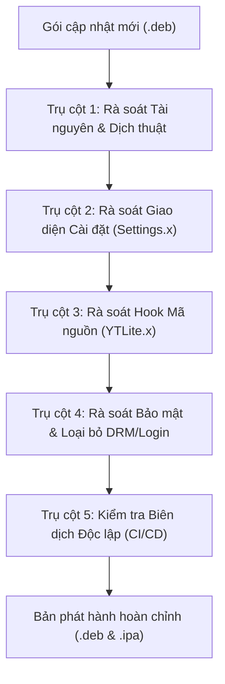

# 📋 Quy trình Kiểm tra & Đối chiếu Cập nhật YTLite (Future Update Checklist)

Tài liệu này đóng vai trò là **Quy chuẩn Kiểm tra Chuẩn (SOP - Standard Operating Procedure)** cho mỗi lần có bản phát hành mới của YouTube hoặc bản phát hành đóng gói từ tác giả cũ (ví dụ: v6.1, v6.2, v7.0...). Quy trình này đảm bảo duy trì mã nguồn **100% Đầy đủ tính năng**, **100% Miễn phí không login/DRM**, và **Biên dịch độc lập thành công**.

---

## 🔍 Tổng quan 5 Trụ cột Kiểm tra (5 Pillars)



---

## 1. 📦 Trụ cột 1: Rà soát Tài nguyên & Ngôn ngữ (`Localizable.strings`)

Mỗi khi có bản `.deb` mới (hoặc binary release):
* [ ] **Giải nén file `.deb`**: Trích xuất `data.tar.lzma` để lấy thư mục `Library/Application Support/YTLite.bundle/`.
* [ ] **Chuyển đổi bplist00**: Các file `.strings` trong bản build iOS thường là binary plist (`bplist00`), cần đọc bằng Python `plistlib`.
* [ ] **Chạy công cụ kiểm tra tự động**:
  ```bash
  python tools/audit_update.py <path_to_new_version.deb>
  ```
* [ ] **So sánh danh sách Key**:
  * [ ] Xác định các key mới xuất hiện so với bản hiện tại trong repo (`layout/.../en.lproj/Localizable.strings`).
  * [ ] Phân loại các key:
    * **Key tính năng mới**: Bổ sung vào toàn bộ 13 file `Localizable.strings` (`en`, `vi`, `ja`, `zh`, v.v.).
    * **Key đăng nhập / DRM / Bản quyền**: Lập tức loại bỏ, không đưa vào mã nguồn.

---

## 2. 🎛️ Trụ cột 2: Rà soát Giao diện Cài đặt (`Settings.x`)

Một tính năng chỉ có ý nghĩa khi người dùng có thể nhìn thấy và bật/tắt trong Cài đặt:
* [ ] **Kiểm tra độ phủ công tắc (Switch Coverage)**:
  * [ ] Mỗi key tính năng mới phải có dòng `[self switchWithTitle:@"KeyTitle" key:@"keyName"]` trong `Settings.x`.
  * [ ] Đặt vào đúng 1 trong 13 chuyên mục:
    1. `General` (Chung)
    2. `Appearance & Theme` (OLED, Kính mờ, Giao diện cũ)
    3. `DownloadManager` (Trình quản lý tải xuống)
    4. `Navbar` (Thanh điều hướng)
    5. `Player` (Trình phát video)
    6. `Player.Actions` (Các nút dưới video: Ask, Clip, Hype, Remix, Thanks, Sub...)
    7. `Overlay` (Lớp phủ màn hình & nút điều khiển: PiP, Mute, Lock, Loop...)
    8. `Player.Gestures` (Cử chỉ vuốt/chạm tua, chỉnh sáng, chỉnh tốc độ...)
    9. `Shorts` (Tất cả nút ẩn và tự động lướt Shorts)
    10. `Tabbar` (Thanh tab dưới đáy)
    11. `Feed` (Bộ lọc bảng tin: Playables, Hội viên, Livestream, Mix, Bài viết...)
    12. `EnableSponsorBlock` (Chặn đoạn tài trợ, intro, outro, haptic...)
    13. `Other` (Menu 3 chấm & tiện ích khác)
* [ ] **Kiểm tra Fallback chèn Menu**:
  * [ ] Đảm bảo hook `+ (NSArray *)settingsCategoryOrder` luôn có khối `else` để chèn mục `YTLiteSection` kể cả khi YouTube đổi ID mục General (tránh bị mất menu cài đặt).
* [ ] **Kiểm tra Mặc định (`registerDefaults`)**:
  * [ ] Đảm bảo `advancedMode = YES` luôn được nạp sẵn trong `Utils/YTLUserDefaults.m`.

---

## 3. 🧩 Trụ cột 3: Rà soát Hook Mã nguồn (`YTLite.x`)

* [ ] **Kiểm tra tính năng thực thi**:
  * [ ] Đảm bảo mỗi công tắc trong `Settings.x` đều có hook tương ứng trong `YTLite.x` thông qua macro `ytlBool(@"keyName")` hoặc `ytlInt(@"keyName")`.
* [ ] **Đối chiếu Symbol & Class YouTube**:
  * [ ] Sử dụng công cụ REA hoặc kiểm tra chuỗi Mach-O trong `YTLite.dylib` mới để phát hiện nếu YouTube cập nhật:
    * Tên class thay đổi (ví dụ: `YTReelWatchPlaybackOverlayView`, `ASCollectionView`, `YTAsyncCollectionView`...).
    * Tên selector thay đổi.
* [ ] **Kiểm tra tương thích nút bấm**:
  * [ ] Kiểm tra hàm `findCell(...)` trong `ASCollectionView` để đảm bảo chuỗi nhận diện nút dưới player (`id.video.*`) vẫn khớp với phiên bản YouTube mục tiêu.

---

## 4. 🛡️ Trụ cột 4: Bảo đảm Tuyệt đối Miễn phí & Không Login/DRM

* [ ] **Rà soát Framework**:
  * [ ] Không liên kết các framework phục vụ xác thực thu phí: `AuthenticationServices.framework`, `LocalAuthentication.framework`, `WebKit.framework` (đăng nhập webview Patreon).
* [ ] **Rà soát Mã nguồn**:
  * [ ] Không chứa các hàm gọi API kiểm tra Token, Check License, hoặc giới hạn số lượng thiết bị (`Access.DeviceLimit`).
  * [ ] Loại bỏ hoàn toàn các thông báo nag alert (popup nhắc đóng tiền/đăng nhập).
  * [ ] Đảm bảo tweak chạy ngoại tuyến 100% (Offline-first).

---

## 5. 🚀 Trụ cột 5: Kiểm tra Biên dịch Độc lập (CI/CD)

* [ ] **Không phụ thuộc header không ổn định**:
  * [ ] Tuyệt đối không `#import` các file protobuf ngoài dễ bị thay đổi cấu trúc từ repo upstream (như bài học lỗi `GPBUnknownFieldSet.h`). Giữ nguyên khai báo interface nội bộ gọn nhẹ trong `YTNativeShare.x`.
* [ ] **Kiểm tra Makefile**:
  * [ ] Khai báo đủ framework cần thiết: `UIKit Foundation SystemConfiguration AVFoundation AVKit Photos`.
  * [ ] Luôn duy trì cờ `-Wno-error` trong `CFLAGS` để các cảnh báo nhỏ của Clang không làm sập tiến trình build CI trên GitHub Actions.
* [ ] **Kiểm tra Workflow GitHub Actions**:
  * [ ] `.github/workflows/_build_tweaks.yml`: Phải chạy lệnh biên dịch trực tiếp từ repo:
    ```bash
    make clean package DEBUG=0 FINALPACKAGE=1
    ```
  * [ ] Không tải file `.deb` đóng sẵn từ releases của bên thứ ba.
* [ ] **Chạy lệnh tự kiểm tra**:
  ```bash
  python tools/audit_update.py
  ```
  Kết quả phải báo: `[SUCCESS] All feature keys in repo have corresponding entries in Settings.x!`
